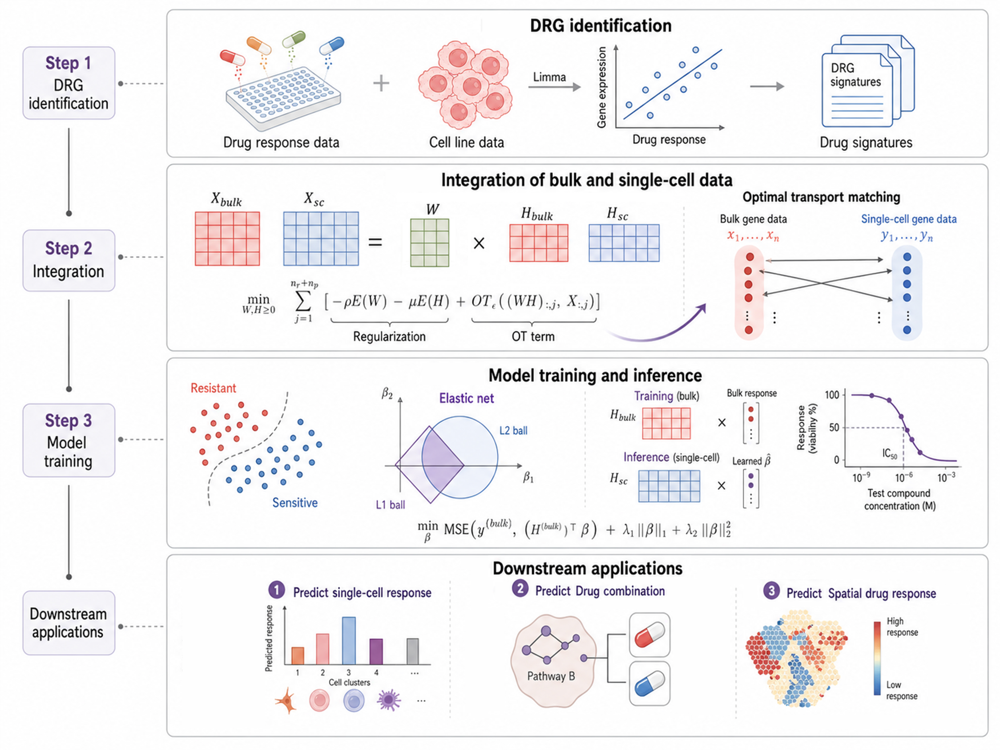

# scVOLT

scVOLT is a Python package for predicting cancer drug-response states in single-cell and spatial transcriptomic data. It uses bulk pharmacogenomic resources as the supervised response source, selects drug response-related genes, aligns bulk and high-resolution expression profiles with optimal transport-guided matrix factorization, and transfers a bulk-trained ElasticNet response model to target cells or spatial spots.

This repository provides the model implementation, bundled pharmacogenomic resources and drug signatures, analysis notebooks for the manuscript experiments, and R scripts for reproducing paper figures. It is intended for reproducing the reported single-cell benchmark, Bortezomib time-course analysis, and breast-cancer spatial drug-response analysis, as well as for applying scVOLT to new transcriptomic datasets.

## Model Overview



scVOLT first identifies drug response-related genes from bulk pharmacogenomic resources, then learns OT-guided metagene representations that align bulk and target high-resolution profiles, and finally applies a bulk-trained ElasticNet response model to single-cell or spatial transcriptomic data.

## Repository Layout

- `src/scvolt/`: installable Python package and bundled bulk resources/signature genes.
- `analyses/`: notebooks for single-cell benchmark, time-course, and spatial analyses.
- `R scripts/`: R plotting scripts for paper figures.
- `data/`: expected local input-data layout. Processed input data are provided through the [Figshare private link](https://figshare.com/s/4ce6b177cd5f04ea7cba) and are not committed to Git.
- `results/`: generated analysis outputs and figure source tables. This directory is ignored by default.

## Installation

Use Python 3.10 or newer. A CUDA-enabled PyTorch installation is recommended for the matrix-factorization step, but the package can also run on CPU for smaller examples.

```bash
cd scvolt
python -m venv .venv
.venv\Scripts\activate
python -m pip install --upgrade pip
python -m pip install -e ".[analysis]"
```

For Linux or macOS, activate the environment with:

```bash
source .venv/bin/activate
```

The optional `analysis` dependencies install packages used by the notebooks, including `anndata`, `scanpy`, `matplotlib`, `seaborn`, `gseapy`, `openpyxl`, and `jupyter`.

R figure scripts were tested with R 4.3.3. Install the R packages used by the scripts with:

```r
install.packages(c("ggplot2", "dplyr", "tidyr", "data.table", "uwot", "scales"))
```

## Basic Usage

Input expression matrices should be non-negative and formatted as cells/spots by genes, with gene symbols matching the bundled CTRP/CCLE resources.

```python
import pandas as pd
import torch
from scvolt import SCVOLTModel, tools

tools.set_model_seed(43)

# expr_df: rows are cells or spots, columns are genes.
expr_df = pd.read_csv("path/to/expression_matrix.csv", index_col=0)

model = SCVOLTModel(
    drug_name="Lapatinib",
    latent_dim=30,
    num_DRGs=1200,
)

encoded = model.encode(
    data={"sc": expr_df},
    device=torch.device("cuda" if torch.cuda.is_available() else "cpu"),
)

pred = model.predict(encoded)
scores = pred["sc_scores"]
```

The returned scores are clipped to the `[0, 1]` drug-response scale used by the bulk response resource. For sensitivity-oriented analyses, use a monotonic transformation such as `1 - score` or rank-normalized sensitivity scores, and interpret them as relative rankings rather than calibrated probabilities.

Available CTRP drugs can be listed with:

```python
from scvolt import SCVOLTModel
print(SCVOLTModel.get_drugs())
```

## Reproducing Paper Analyses

Download the processed input data from the [Figshare private link](https://figshare.com/s/4ce6b177cd5f04ea7cba) and extract the archive at the repository root so that the `data/` layout matches `data/README.md`. The notebooks resolve paths from the project root and write generated outputs under `results/`:

- `analyses/single_cell_prediction.ipynb`: benchmark single-cell drug-response datasets in `data/01_single_cell_prediction/`; writes metrics to `results/01_single_cell_prediction/`.
- `analyses/time_series_analysis.ipynb`: Bortezomib time-course analysis for `GSE114461_Bortezomib.csv.gz`; writes scores to `results/02_time_series_analysis/`.
- `analyses/spatial_analysis.ipynb`: spatial breast-cancer analysis using `V19L29-097.h5ad` and external GDSC2 Dasatinib response records; writes figures and tables to `results/03_spatial_analysis/`.

R scripts should be run from the `R scripts/` directory. They save PDF figures to `R scripts/figures/`; this output directory is ignored by default. For the time-course figure scripts, run `02_create_umap_df.R` first in the same R session, then run the plotting scripts that use `umap_df` or `plot_df`.

## Data Notes

The package includes the processed CTRP/CCLE resources and CTRP drug-response gene signatures required by the model. The processed input datasets used by the analysis notebooks are available through the [Figshare private link](https://figshare.com/s/4ce6b177cd5f04ea7cba). File names, expected paths, sizes, and SHA256 checksums are documented in `data/README.md`.

The large processed data files are not committed to this repository. After downloading the data archive, extract it at the repository root so the `data/` directory contains the expected subdirectories.

## Upload Checklist

Before submitting or archiving the repository, exclude generated and machine-local files:

- `.idea/`, `build/`, `dist/`, `*.egg-info/`, `__pycache__/`, and `.ipynb_checkpoints/`.
- large processed files under `data/`; keep only `data/README.md` in Git.
- `results/` and `R scripts/figures/` unless a specific review package asks for generated outputs.
- `R scripts/.RData` and `R scripts/.Rhistory`.

Notebook outputs should be cleared before upload unless the venue explicitly asks for executed notebooks. Re-run notebooks from a clean environment when preparing the final reproducibility archive.

## License

During anonymous review, use and redistribution follow the conference policy for code availability and anonymized supplemental material. A formal open-source license will be added for the public release.
